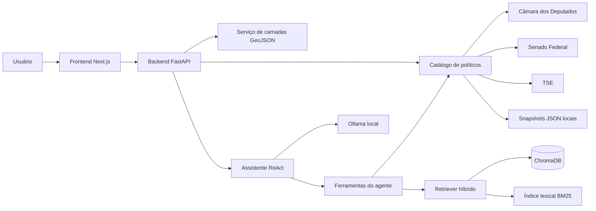

# Politizese

Plataforma web de informação política e interesse público, criada para facilitar o acesso, a compreensão e o acompanhamento de dados sobre representantes, instituições e assuntos que afetam a vida dos cidadãos.

O Politize-se reúne, em um mesmo ambiente, um catálogo de representantes públicos, perfis individuais, um mapa territorial com dados públicos e um assistente virtual baseado em modelos locais. A proposta é apresentar informações de forma acessível, mantendo a origem dos dados visível e permitindo que cada pessoa forme suas próprias conclusões.

# integrantes

570021 - VICTOR HENRIQUE NOGUEIRA BEZERRA 
573334 -CARLOS HENRIQUE SANTOS DIAS 
574156 - GUSTAVO ARAUJO RAMOS DA SILVA

> **Princípio do projeto:** a plataforma informa, organiza e contextualiza. Não tem como objetivo direcionar o posicionamento político do usuário.

---

## Sumário

- [Objetivos](#objetivos)
- [Funcionalidades implementadas](#funcionalidades-implementadas)
- [Arquitetura](#arquitetura)
- [Tecnologias](#tecnologias)
- [Fontes de dados](#fontes-de-dados)
- [Estrutura do projeto](#estrutura-do-projeto)
- [Requisitos para execução](#requisitos-para-execução)
- [Configuração](#configuração)
- [Como executar](#como-executar)
- [API](#api)
- [Como funciona o assistente](#como-funciona-o-assistente)
- [Indexação e atualização de dados](#indexação-e-atualização-de-dados)
- [Base documental simulada e armadilhas](#base-documental-simulada-e-armadilhas)
- [Testes](#testes)
- [Limitações conhecidas](#limitações-conhecidas)
- [Próximos passos](#próximos-passos)
- [Licença](#licença)

---

## Objetivos

O projeto busca reduzir a fragmentação das informações políticas e públicas, permitindo que o cidadão:

- consulte representantes por nome, cargo, partido e localização;
- abra páginas individuais com os dados disponíveis de cada representante;
- visualize obras, áreas de risco e ocorrências territoriais em um mapa;
- faça perguntas sobre a Constituição e assuntos políticos a um assistente virtual;
- consulte as referências utilizadas nas respostas e identifique limitações quando não houver evidência suficiente.

O desenvolvimento segue cinco princípios: **transparência**, **imparcialidade metodológica**, **auditabilidade**, **privacidade** e **liberdade de acesso à informação**.

## Funcionalidades implementadas

### Catálogo de políticos

A aba **Políticos** consome o catálogo unificado da API e permite filtrar os registros por:

- nome;
- cargo;
- UF;
- município;
- partido;
- fase do mandato.

A listagem possui paginação e apresenta o estado das fontes de dados. Cada card é clicável e abre um perfil interno em `/dashboard/politicos/{id}`.

Os perfis apresentam os campos disponíveis no cadastro, como nome, cargo, partido, estado, município, mandato, situação, titularidade, informações eleitorais e contatos. Quando a fonte não fornece uma fotografia, a interface utiliza as iniciais do nome como alternativa.

### Assistente virtual

O assistente está integrado ao frontend principal em `/dashboard/assistente`. A interface permite manter uma conversa, iniciar uma nova sessão, visualizar as ferramentas utilizadas e consultar referências documentais ou perfis de políticos.

O assistente utiliza modelos executados localmente pelo Ollama. Seu fluxo combina recuperação documental, ferramentas especializadas e guardrails para restringir o escopo e tratar entradas com dados pessoais.

### Mapa territorial

A página `/dashboard/map` apresenta um mapa interativo com camadas GeoJSON disponibilizadas pelo backend. As camadas implementadas incluem:

- obras públicas;
- áreas de risco hidrológico;
- áreas de risco geológico;
- ocorrências de alagamento;
- ocorrências de inundação;
- ocorrências de deslizamento;
- ocorrências de queda de árvores.

O usuário pode ativar as camadas disponíveis e consultar os atributos dos elementos exibidos no mapa. A visualização utiliza Leaflet/React-Leaflet, com mapa-base e atribuições do OpenStreetMap e CARTO.

### Dashboard inicial

A rota `/dashboard` contém a estrutura visual inicial e cartões de conteúdo demonstrativos. Os cartões e textos de exemplo não devem ser interpretados como um feed jornalístico conectado a uma fonte de notícias.

## Arquitetura

O projeto utiliza uma arquitetura dividida entre frontend, API, serviços de integração e módulos de recuperação e geração de respostas.



### Frontend

O frontend utiliza Next.js com Pages Router, React e TypeScript. As páginas consomem a API FastAPI por requisições HTTP. A página do mapa utiliza React-Leaflet para renderizar as camadas geográficas.

### Backend

O backend é construído com FastAPI e Pydantic. Os routers recebem e validam as requisições, enquanto os serviços concentram as consultas às fontes externas, normalização, cache e acesso aos dados locais.

### Armazenamento atual

Nesta versão, os dados do catálogo são mantidos em snapshots JSON por fonte, dentro de `data/cache/politicos/`. O índice vetorial do assistente é persistido no ChromaDB, dentro de `data/chroma_db/`.

**Ainda não há PostgreSQL, SQLAlchemy, Firebase ou Redis integrados como armazenamento principal nesta versão.** O histórico conversacional do assistente é mantido em memória pelo processo Python; reiniciar o backend limpa as sessões existentes.

## Tecnologias

| Camada | Tecnologias | Responsabilidade |
|---|---|---|
| Frontend | Next.js, React, TypeScript, Tailwind CSS | Páginas, componentes e interação com o usuário |
| Mapa | Leaflet, React-Leaflet, GeoJSON | Renderização de obras, riscos e ocorrências |
| Backend | Python, FastAPI, Pydantic | APIs, validação e regras de integração |
| Modelos de linguagem | Ollama local, Qwen/Gemma configuráveis | Interpretação e geração de respostas |
| Orquestração de IA | LangChain, LCEL e agente ReAct | Pipelines, memória e chamada de ferramentas |
| RAG | ChromaDB, embeddings, BM25, RRF e reranker | Recuperação e classificação de evidências |
| Avaliação | RAGAS, pytest | Avaliação experimental e testes automatizados |

O cliente `ChatOpenAI` utilizado pelo agente é configurado para conversar com o endpoint OpenAI-compatível servido **localmente pelo Ollama** (`http://localhost:11434/v1`). Isso não significa que o projeto envie as conversas para a API da OpenAI.

## Fontes de dados

O catálogo unificado combina fontes públicas com estruturas normalizadas pelo backend.

| Fonte | Conteúdo utilizado | Observações |
|---|---|---|
| Câmara dos Deputados | Deputados federais em exercício | Integração com a API de Dados Abertos da Câmara |
| Senado Federal | Senadores em exercício | Integração com a API de Dados Abertos do Senado |
| TSE — eleições gerais de 2026 | Governadores e deputados estaduais/distritais eleitos | Registros classificados como `eleito_futuro` no modelo de dados |
| TSE — eleições municipais de 2024 | Prefeitos e vereadores eleitos | A eleição não comprova, por si só, o exercício individual atual do mandato |
| Cadastro local da Presidência | Registros provisórios de presidente e vice-presidente | Ainda sem atualização automática por API no serviço atual |
| GeoSampa / Prefeitura de São Paulo | Obras, áreas de risco e ocorrências geográficas | Camadas disponibilizadas localmente em arquivos GeoJSON |

Referências das fontes utilizadas:

- [Dados Abertos da Câmara dos Deputados](https://dadosabertos.camara.leg.br/swagger/api.html)
- [Dados Abertos do Senado Federal](https://www12.senado.leg.br/dados-abertos)
- [Dados Abertos do TSE](https://dadosabertos.tse.jus.br/)
- [GeoSampa — Prefeitura de São Paulo](https://geosampa.prefeitura.sp.gov.br/)

### Fases de mandato

O catálogo diferencia três fases para evitar que um resultado eleitoral seja apresentado automaticamente como confirmação de exercício atual:

- `em_exercicio`: registro fornecido pela fonte como ocupante em exercício;
- `eleito_futuro`: pessoa eleita para um mandato posterior, conforme a base eleitoral integrada;
- `mandato_em_andamento`: registro originado dos eleitos municipais de 2024; o cadastro não confirma individualmente que a pessoa continua no exercício do cargo.

O status de atualização de cada origem também é informado pela API (`atualizada`, `cache_valido`, `cache_desatualizado`, `indisponivel` ou `cadastro_local`). Um cache válido indica que o snapshot local está dentro do prazo configurado, não que a fonte foi consultada novamente em cada requisição.

## Estrutura do projeto

Estrutura resumida dos diretórios principais:

```text
politizese_ai/
├── backend/
│   ├── router/                 # Rotas da API
│   ├── schemas/                # Contratos e validação Pydantic
│   ├── services/               # Câmara, Senado, TSE e catálogo unificado
│   └── main.py                 # Inicialização FastAPI e rotas do mapa
├── configs/
│   └── avaliacoes/             # Configurações dos experimentos
├── data/
│   ├── cache/politicos/        # Snapshots JSON das fontes políticas
│   ├── chroma_db/              # Persistência local do ChromaDB
│   ├── evaluation/             # Perguntas e resultados RAGAS
│   │   └── templates/          # Estruturas vazias para novos conjuntos de avaliação
│   ├── geosampa/               # GeoJSONs e dados territoriais processados
│   ├── obras/                  # Dados de obras públicas
│   ├── metrics/                # Métricas e auditorias de indexação
│   └── processed/              # Árvores jurídicas e índices processados
├── frontend/
│   └── src/
│       ├── components/         # Componentes de interface
│       ├── hooks/              # Hooks de dados
│       ├── pages/              # Rotas Next.js
│       ├── services/           # Clientes HTTP
│       └── types/              # Tipos TypeScript
├── knowledge/                  # Documentos usados como conhecimento
│   └── base_simulada_politica/ # Leis e resolução fictícias em Markdown
├── prompts/                    # Prompts centrais, tarefas e estilos
│   └── tasks/
│       └── react_agent_legislativo.xml # Instruções para o acervo legislativo simulado
├── scripts/                    # Importação, inspeção e avaliação
│   └── indexar_base_simulada.py # Indexação separada dos documentos Markdown
├── services/                   # Carregamento e processamento documental
├── src/
│   ├── agents/                 # Agente ReAct, ferramentas e autorização
│   ├── ai/                     # Fábricas de modelos e carregamento de prompts
│   ├── chain/                  # Memória e pipelines LCEL
│   ├── core/                   # Configurações centrais
│   ├── evaluation/              # Avaliação dos retrievers
│   ├── guardrails/              # Escopo e moderação
│   └── rag/                     # Chunking, embeddings e recuperação
├── tests/                      # Testes automatizados
├── indexar_base.py             # Indexador jurídico original
├── indexar_base_clean_v2.py    # Indexador limpo da Constituição
├── requirements.txt
└── .env.example
```

## Requisitos para execução

- Python e `pip`, em versão compatível com as dependências fixadas em `requirements.txt`;
- Node.js e npm;
- Ollama instalado e em execução;
- os modelos locais definidos no `.env`;
- os dados locais do ChromaDB e os arquivos necessários em `knowledge/` e `data/`.

O projeto foi desenvolvido para execução local. A configuração do assistente web atual exige `OLLAMA_PROVIDER=local`.

## Configuração

### 1. Criar e ativar o ambiente Python

No Windows PowerShell:

```powershell
py -m venv .venv
.\.venv\Scripts\Activate.ps1
```

No Git Bash:

```bash
python -m venv .venv
source .venv/Scripts/activate
```

No Linux/macOS:

```bash
python -m venv .venv
source .venv/bin/activate
```

### 2. Instalar dependências do backend e da IA

Na raiz do repositório:

```bash
python -m pip install --upgrade pip
pip install -r requirements.txt
```

O arquivo de dependências inclui bibliotecas de LangChain, ChromaDB, sentence-transformers, RAGAS e PyTorch. A instalação do PyTorch pode depender do sistema operacional, da versão do Python e do suporte de hardware disponível; o `requirements.txt` deste projeto aponta para wheels CUDA 12.8.

### 3. Instalar e conferir os modelos do Ollama

Verifique se o Ollama está disponível:

```bash
ollama --version
ollama list
```

Os nomes de modelos usados na configuração local mais recente do projeto foram:

```bash
ollama pull qwen3.5:9b
ollama pull gemma4:12b
ollama pull nomic-embed-text
```

Execute `ollama pull` apenas para os modelos que ainda não estiverem instalados. Os modelos podem ser alterados no `.env`, desde que estejam disponíveis no Ollama e sejam compatíveis com as tarefas correspondentes.

### 4. Configurar as variáveis de ambiente

Crie o `.env` a partir do exemplo:

PowerShell:

```powershell
Copy-Item .env.example .env
```

Git Bash/Linux/macOS:

```bash
cp .env.example .env
```

Exemplo de configuração local:

```env
APP_NAME="Politize-se AI"
ENVIRONMENT=development

OLLAMA_PROVIDER=local
OLLAMA_LOCAL_BASE_URL=http://localhost:11434
LLM_MODEL=qwen3.5:9b
LLM_TEMPERATURE=0.3
LLM_TOP_P=0.9
LLM_NUM_PREDICT=1200

SEMANTIC_INDEX_PROVIDER=local
SEMANTIC_INDEX_MODEL=gemma4:12b
SEMANTIC_INDEX_TEMPERATURE=0.1
SEMANTIC_INDEX_TOP_P=0.9
SEMANTIC_INDEX_NUM_PREDICT=4096
SEMANTIC_INDEX_NUM_CTX=8192

SYSTEM_PROMPT_FILE=system_prompt_v1.md

RAG_EMBEDDING_PROVIDER=local
RAG_EMBEDDING_MODEL=nomic-embed-text

CHROMA_PERSIST_DIRECTORY=data/chroma_db
CHROMA_COLLECTION_PREFIX=politizese
DOCUMENTS_DIRECTORY=knowledge
```

Ajuste `LLM_MODEL`, `SEMANTIC_INDEX_MODEL` e `RAG_EMBEDDING_MODEL` para os nomes existentes no seu `ollama list`. Para o assistente atual, mantenha `OLLAMA_PROVIDER=local`, `SEMANTIC_INDEX_PROVIDER=local` e `RAG_EMBEDDING_PROVIDER=local`.

**Não coloque chaves, senhas ou credenciais no repositório.** O arquivo `.env` deve permanecer local e ignorado pelo Git.

### 5. Configurar o frontend

Crie `frontend/.env.local` (se necessário) com:

```env
NEXT_PUBLIC_API_URL=http://127.0.0.1:8000
```

O mapa também lê `NEXT_PUBLIC_CARTO_API_KEY`; quando houver uma chave disponibilizada para o projeto, ela pode ser configurada nesse mesmo arquivo.

## Como executar

Abra dois terminais. O Ollama precisa continuar ativo durante o uso do assistente.

### Terminal 1 — backend

Na raiz do repositório, com a `.venv` ativada:

```bash
uvicorn backend.main:app --reload --host 127.0.0.1 --port 8000
```

A documentação interativa da API ficará disponível em:

- `http://127.0.0.1:8000/docs`
- `http://127.0.0.1:8000/redoc`

Verificação de saúde:

- `http://127.0.0.1:8000/api/health`

### Terminal 2 — frontend

```bash
cd frontend
npm install
npm run dev
```

A aplicação ficará disponível em `http://localhost:3000`.

Rotas principais:

- `/dashboard` — início;
- `/dashboard/politicos` — catálogo de representantes;
- `/dashboard/politicos/{id}` — perfil individual;
- `/dashboard/map` — mapa territorial;
- `/dashboard/assistente` — assistente virtual.

> **Nota sobre o pacote frontend:** o ZIP do projeto utilizado para preparar esta documentação não continha `frontend/package.json`, arquivo de lock nem `frontend/tsconfig.json`. Confirme que esses arquivos existem e estão versionados no repositório completo antes de distribuir o projeto; sem o manifesto do npm, uma instalação limpa do frontend não é reproduzível.

## API

As rotas principais implementadas são:

| Método | Rota | Descrição |
|---|---|---|
| `GET` | `/` | Informações básicas da API |
| `GET` | `/api/health` | Verificação de saúde |
| `GET` | `/api/map/layers` | Lista as camadas geográficas e sua disponibilidade |
| `GET` | `/api/map/layers/{layer_id}` | Retorna uma camada GeoJSON |
| `GET` | `/api/politicos` | Consulta o catálogo unificado |
| `GET` | `/api/politicos/{politico_id}` | Consulta um perfil individual |
| `GET` | `/api/politicos/senadores` | Rota específica de senadores mantida por compatibilidade |
| `GET` | `/api/deputados` | Rota legada de deputados federais |
| `GET` | `/api/deputados/{deputado_id}` | Perfil legado de deputado federal |
| `GET` | `/api/assistente/status` | Estado de inicialização do assistente |
| `POST` | `/api/assistente/chat` | Envia uma mensagem ao assistente |
| `DELETE` | `/api/assistente/sessoes/{session_id}` | Limpa a sessão conversacional |

### Exemplo: consultar senadores em exercício de São Paulo

```http
GET /api/politicos?cargo=senador&uf=SP&fase_mandato=em_exercicio&pagina=1&itens=20
```

### Filtros do catálogo

- `nome`: busca textual por nome;
- `cargo`: slug do cargo, como `senador`, `deputado_federal`, `governador`, `prefeito` ou `vereador`;
- `uf`: sigla do estado;
- `municipio`: nome do município;
- `partido`: sigla do partido;
- `fase_mandato`: `em_exercicio`, `eleito_futuro` ou `mandato_em_andamento`;
- `pagina`: página da listagem;
- `itens`: quantidade por página (de 1 a 100).

### Exemplo: conversar com o assistente

```http
POST /api/assistente/chat
Content-Type: application/json
```

```json
{
  "session_id": "58c2e70d-a193-4b27-8a5f-6ce4f7cdbb0b",
  "message": "Quais são os fundamentos da República Federativa do Brasil?"
}
```

A resposta inclui o texto do assistente, fontes, ferramentas utilizadas, quantidade de chamadas e tempo total de processamento.

## Como funciona o assistente

O assistente combina um agente ReAct com ferramentas especializadas:

| Ferramenta | Responsabilidade |
|---|---|
| `search_constitution` | Pesquisa informações na Constituição Federal |
| `search_constitution_decomposed` | Decompõe perguntas com várias necessidades e recupera evidências para cada parte |
| `search_politicos` | Consulta o catálogo estruturado de representantes |
| `calculate_voting_threshold` | Calcula deterministicamente limiares de votação e quórum |

O agente possui limite de até seis chamadas de ferramentas por pergunta. O sistema também utiliza:

- **RAG híbrido:** combina recuperação vetorial no ChromaDB com recuperação lexical BM25;
- **RRF:** Reciprocal Rank Fusion para combinar listas de candidatos;
- **Query Rewriter:** reformula a consulta para melhorar a recuperação;
- **Question Decomposer:** divide perguntas compostas em subperguntas;
- **Reranker:** reordena candidatos recuperados para priorizar trechos relevantes;
- **Guardrails:** validação de escopo, moderação de dados pessoais e autorização de ferramentas;
- **Referências:** identificadores documentais e links para perfis internos de políticos.

O pipeline LCEL também está disponível em `src/chain/rag_pipeline.py`, separado do ciclo ReAct, para execução e demonstração do fluxo RAG.

### Importante sobre confiabilidade

O assistente é um recurso experimental em evolução. A recuperação de um documento não garante que a síntese esteja correta: o modelo pode interpretar um trecho incorretamente ou produzir uma resposta imprecisa. Em especial para temas jurídicos, eleitorais ou de mandato, confira os dispositivos e registros citados nas fontes oficiais. A interface e as referências facilitam essa conferência, mas não substituem a validação.

## Indexação e atualização de dados

### Constituição e ChromaDB

O documento jurídico atualmente incluído em `knowledge/` é `Constituicao-Brasil-EC139-2026.pdf`. O índice vetorial persistente fica em `data/chroma_db/`, e os dados processados e métricas ficam em `data/processed/` e `data/metrics/`.

O script `indexar_base_clean_v2.py` executa uma reindexação limpa da Constituição, criando uma coleção de destino própria e validando os IDs persistidos. Ele utiliza um parser jurídico específico para a Constituição Federal.

```bash
python indexar_base_clean_v2.py
```

**Atenção:** esse script continua específico para a Constituição Federal e não é um indexador genérico. Não copie documentos de outro assunto para `knowledge/` esperando que sejam incorporados automaticamente. Para a base Markdown da atividade, utilize o fluxo separado descrito em [Base documental simulada e armadilhas](#base-documental-simulada-e-armadilhas). Outras bases exigem carregador, parser, metadados, estratégia de chunking e índices vetorial e lexical próprios.

A nomeação da coleção vetorial considera o modelo/provedor de embeddings e o perfil de geração utilizado. Não misture vetores produzidos por configurações incompatíveis; mantenha os metadados de modelo e perfil consistentes.

### Base documental simulada e armadilhas

Para a avaliação acadêmica de recuperação documental, foi criada uma base legislativa inteiramente fictícia, separada dos documentos oficiais que alimentam o restante do projeto. Os nomes, órgãos, leis, datas e regras abaixo existem somente para testar o RAG; não representam legislação municipal real.

Os três documentos Markdown ficam em `knowledge/base_simulada_politica/`. Cada corpo documental, sem contar o front matter de metadados, permanece entre 100 e 200 palavras. Todos incluem `titulo`, `data_publicacao` e `tema`:

| Arquivo | Publicação | Função na base |
|---|---:|---|
| `doc_01_lei_orcamento_participativo.md` | 20/03/2026 | Lei original que institui o Programa Municipal de Participação Cidadã. |
| `doc_02_lei_alteracao_participacao.md` | 03/10/2026 | Lei posterior que altera a elegibilidade para votação e o calendário das consultas. |
| `doc_03_resolucao_apoio_propostas.md` | 15/10/2026 | Resolução complementar com requisitos operacionais para protocolar propostas. |

#### Armadilha 1 — alteração legislativa e desatualização

A Lei Municipal fictícia nº 2.140/2026, em seu art. 3º, permite que residentes a partir de 16 anos apresentem propostas e votem nas consultas. Seu art. 4º prevê consultas no primeiro sábado do mês, das 9h às 16h.

A Lei Municipal fictícia nº 2.196/2026 altera expressamente esses dispositivos e entra em vigor em 1º de novembro de 2026. A partir dessa data, residentes de 16 e 17 anos podem apresentar propostas e participar das audiências, mas o voto nas consultas fica reservado a pessoas com 18 anos ou mais. O calendário também muda para o terceiro sábado do mês, das 9h às 13h.

A recuperação correta exige identificar o dispositivo alterado e considerar a data de entrada em vigor. A norma anterior continua útil para compreender o histórico, mas sua redação original não deve ser apresentada como regra aplicável depois da vigência da alteração. A mudança não revoga automaticamente os artigos que não foram modificados.

#### Armadilha 2 — condição específica e documentação de apoio

A Resolução Administrativa fictícia nº 08/2026 complementa o procedimento de apresentação de propostas. Seu art. 3º exige pelo menos 25 manifestações válidas de apoio. O art. 4º acrescenta uma condição territorial para propostas de intervenção localizada: pelo menos 15 manifestações devem partir de residentes do distrito administrativo diretamente afetado. O § 2º do mesmo artigo excepciona propostas de alcance geral, que abranjam todo o Município.

Esse requisito territorial está em um dispositivo interno da resolução, não no título nem no parágrafo introdutório. Por isso, uma resposta sobre a quantidade de apoios não pode se limitar à recuperação da lei principal ou ao início da resolução: deve localizar e combinar o artigo e o parágrafo pertinentes.

#### O que a armadilha deve demonstrar

A base foi estruturada para verificar se o assistente consegue:

- distinguir a data de publicação da data de entrada em vigor;
- reconhecer uma redação alterada sem descartar os dispositivos que permaneceram vigentes;
- diferenciar o direito de apresentar propostas, participar de audiências e votar;
- recuperar uma condição que aparece somente em documentação complementar;
- fundamentar a resposta com o documento e o dispositivo normativo correspondente.

O princípio esperado não é simplesmente escolher sempre o arquivo mais novo. O sistema precisa verificar se o ato posterior efetivamente alterou o dispositivo relevante, quando a alteração passou a produzir efeitos e quais partes da norma original foram preservadas.

#### Validação e indexação da base Markdown

O carregador histórico do projeto lê PDFs no diretório `knowledge/`, e `indexar_base_clean_v2.py` é específico para a Constituição Federal. Portanto, os arquivos Markdown simulados não entram automaticamente na coleção constitucional. Para manter os dois acervos independentes, foi adicionado o indexador `scripts/indexar_base_simulada.py`, que gera uma coleção ChromaDB própria e a árvore jurídica usada pelo BM25.

Primeiro, valide os arquivos e a identificação dos dispositivos sem gerar embeddings:

```bash
python scripts/indexar_base_simulada.py --validate-only
```

Depois, com o ambiente e o Ollama configurados, gere a coleção e a árvore lexical:

```bash
python scripts/indexar_base_simulada.py
```

Saídas esperadas:

- coleção-base ChromaDB: `politizese_politica_simulada_v1` (o nome físico recebe o sufixo do perfil de embeddings);
- árvore jurídica BM25: `data/processed/base_politica_simulada_artigos.json`.

A indexação não substitui nem sobrescreve a coleção da Constituição. O script interrompe a execução se a coleção simulada já contiver registros, para evitar sobrescrita acidental.

#### Estrutura para avaliação RAGAS

Foi criado `data/evaluation/templates/ragas_politica_questions.template.json` com oito registros vazios: quatro classificados como simples e quatro como armadilha. Os campos `user_input`, `reference` e `reference_source` estão intencionalmente em branco. **Este projeto não preenche as perguntas, o ground truth nem resultados de avaliação nesta etapa.** O arquivo é apenas uma estrutura para o grupo completar e revisar.

O avaliador existente recebeu opções para selecionar o arquivo de perguntas, a coleção vetorial, a árvore BM25 e o prompt especializado, sem alterar o comportamento padrão da avaliação constitucional. Depois que o grupo preencher e validar o JSON, o comando para avaliar a base simulada será:

```bash
python scripts/evaluate_ragas.py \
  --questions-file data/evaluation/templates/ragas_politica_questions.template.json \
  --collection politizese_politica_simulada_v1 \
  --legal-tree data/processed/base_politica_simulada_artigos.json \
  --prompt-task react_agent_legislativo \
  --label armadilhas_legislativas
```

O comando acima **não deve ser executado enquanto os campos de pergunta e referência estiverem vazios**. Para grupos em dupla ou trio, o briefing prevê oito perguntas (quatro simples e quatro que exigem as armadilhas); na modalidade individual, o briefing reduz o conjunto para seis (três simples e três armadilha). Ajuste a quantidade de registros do template à modalidade antes da avaliação.

O prompt `prompts/tasks/react_agent_legislativo.xml` orienta o agente a tratar os documentos como acervo normativo selecionado para aquela execução, verificar vigência e alterações e citar os identificadores recuperados.


### Catálogo de políticos

Os snapshots são armazenados em `data/cache/politicos/`, separados por origem (`camara.json`, `senado.json`, `tse.json` e `tse_municipal.json`). O serviço aplica prazos de cache diferentes para cada fonte e pode utilizar o último snapshot disponível quando uma API externa falha. O estado da fonte é devolvido junto com a listagem para que a interface não confunda cache com consulta em tempo real.

## Testes

Para validar especificamente os metadados, a contagem de palavras e a leitura jurídica da base simulada, execute:

```bash
python -m pytest tests/test_simulated_legal_base.py -q
```

Com o ambiente virtual ativado, execute a suíte Python completa:

```bash
python -m pytest -q
```

Alguns testes podem exigir as dependências de IA instaladas e, dependendo do módulo, dados/índices locais disponíveis. Testes que inicializam o agente completo também podem exigir que o Ollama esteja em execução e que os modelos estejam instalados.

Para verificar rapidamente a API, inicie o backend e consulte `/api/health`, `/api/politicos` e `/api/assistente/status`. Para validar o catálogo sem passar pelo modelo, utilize diretamente os filtros da rota `/api/politicos`.

## Limitações conhecidas

- O histórico conversacional fica em memória no backend e é perdido quando o processo reinicia.
- O cadastro de Presidência é provisório e mantido localmente; ainda não há sincronização automática por API.
- Os registros do TSE representam resultados eleitorais e precisam ser interpretados de acordo com `fase_mandato`; eleição não equivale automaticamente a confirmação de exercício atual.
- Nem todas as fontes fornecem URLs de fotografia. Quando não há foto, a interface usa iniciais.
- A base municipal e os registros eleitorais dependem da data e da abrangência dos arquivos oficiais incorporados.
- O assistente ainda pode cometer erros de interpretação ou síntese, mesmo quando apresenta referências; respostas relevantes devem ser conferidas nas fontes originais.
- As áreas de **Seguindo**, **Novidades**, autenticação, personalização avançada e persistência de usuário aparecem na visão do produto, mas não fazem parte do conjunto funcional demonstrado nesta versão.
- O dashboard inicial ainda contém conteúdo demonstrativo.
- A implementação atual não possui banco relacional nem uma camada de autenticação de usuários.

## Próximos passos

A evolução prevista para o Politize-se inclui:

- persistência de usuários, preferências e representantes acompanhados;
- completar as áreas de Seguindo e Novidades;
- expandir os perfis com histórico legislativo, votações, proposições e outras informações públicas;
- ampliar a cobertura territorial e incorporar novas bases documentais;
- enriquecer as fotografias e os links institucionais dos registros que ainda não os possuem;
- fortalecer testes de qualidade factual, guardrails e avaliação contínua do RAG;
- adicionar ingestão documental genérica, com metadados e atualização coordenada dos índices vetorial e lexical.

## Licença

O repositório contém o arquivo `PolyForm NonCommercial 1.0.0.txt`. Consulte o texto integral da licença antes de reutilizar, modificar ou distribuir o projeto. A licença PolyForm Noncommercial estabelece condições específicas para usos não comerciais.

---

Desenvolvido como projeto acadêmico e experimental. Dados e funcionalidades podem estar incompletos ou sujeitos a atualização pelas fontes originais.
